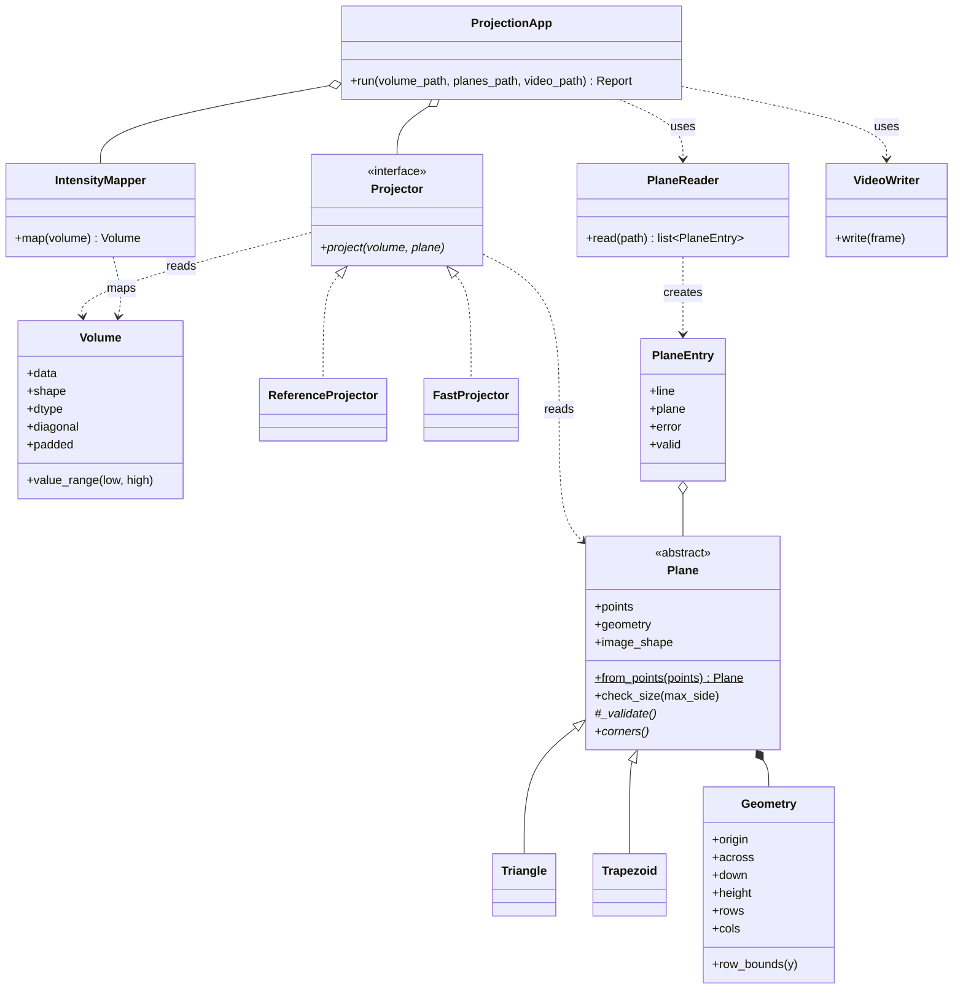

# Design

How the program is divided into classes, and why. The algorithm itself is in
[ALGORITHM.md](ALGORITHM.md); the requirements are in [SRS.md](SRS.md).

## 1. Classes



| Class | Responsibility | Module |
|---|---|---|
| `Volume` | A checked 3D volume (FR-1 – FR-3); its value range; a zero-padded copy for the fast projector | `projection/volume.py` |
| `Plane` | Abstract base: validates on creation (FR-9), so a `Plane` object is always valid; holds its `Geometry` | `projection/plane.py` |
| `Triangle`, `Trapezoid` | The rules of each shape, and its four corners `a1, b, a2, c` | `projection/plane.py` |
| `Geometry` | The image grid laid on the plane (ALGORITHM.md, section 2) | `projection/plane.py` |
| `Projector` | Interface: `project(volume, plane)` returns the plane's image | `projection/projector.py` |
| `ReferenceProjector` | Loops, one pixel at a time | `projection/projector.py` |
| `FastProjector` | NumPy, all pixels at once | `projection/projector.py` |
| `load_volume` | Reads an NRRD file into a `Volume`; any problem becomes an `InputError` | `projection/readers.py` |
| `PlaneReader`, `PlaneEntry` | Reads the CSV file; each line becomes an entry holding a plane or an error, with its line number (FR-4 – FR-7, FR-10) | `projection/readers.py` |
| `IntensityMapper` | Maps the whole volume to `0..255` once (FR-20) | `projection/intensity.py` |
| `VideoWriter`, `frame_shape`, `place` | Frame size, centering, writing the MP4 (FR-19, FR-21, FR-22) | `projection/video.py` |
| `ProjectionApp`, `Report` | The whole run: validation, strict mode, black frames, timing (FR-8 – FR-12, FR-23) | `projection/app.py` |
| `InputError`, `InvalidPlaneError` | The two kinds of errors: stop the run, or one bad plane | `projection/errors.py` |

## 2. Design decisions

**Plane hierarchy (inheritance).** A triangle and a trapezoid have different rules but the
same output: four corners, and from them one geometry. The abstract `Plane` does what is common
(checking the numbers, building the geometry); each subclass adds only its own rules
(`_validate`) and its corners (`corners`). A triangle returns `a, b, a, c`: a trapezoid whose
top is a point. A new shape would be one new subclass, with no change to the projectors.

**Validation in the constructor.** A `Plane` cannot exist unless it is valid, so no other class
needs to check it again. An invalid plane raises `InvalidPlaneError` with a message that says
which rule it broke.

**Projector interface (Strategy pattern).** The program depends only on `Projector`, not on how
it projects. `ReferenceProjector` is written to be read and trusted; `FastProjector` to be
fast. The tests run both on hundreds of random planes and require identical images (NFR-2).
Swapping or adding an algorithm (for example, interpolation) needs no change elsewhere.

**Immutability.** `Geometry` is a frozen dataclass, `Volume.data` is a read-only view and
`Plane.points` returns a copy. Objects are checked once and cannot be changed afterwards.

**A bad CSV line does not stop the reading.** `PlaneReader` turns each line into a
`PlaneEntry` that holds either a plane or an error message, with the line number. All errors are
known before any projection, so they can be reported together, and frame N always matches
plane N (FR-10, FR-11).

**Map the volume once.** `IntensityMapper` returns a new 8-bit `Volume`, and the projector works
on it. The projector does not know about gray levels at all (ALGORITHM.md, section 6).

**The app receives its parts.** `ProjectionApp` gets its projector and mapper from outside
(dependency injection), so tests or experiments can run it with the reference projector or
other percentiles. `Ex0.py` only reads the arguments, calls the app and prints the report.

**Two kinds of errors.** `InputError` and `InvalidPlaneError` are separate classes, so the main
program can stop on the first and draw a black frame for the second (FR-8, FR-11).

## 3. Package layout

```
Ex0.py                  demo entry point: arguments, report, exit codes
projection/
    __init__.py         public classes
    errors.py           InputError, InvalidPlaneError
    volume.py           Volume
    plane.py            Plane, Triangle, Trapezoid, Geometry
    projector.py        Projector, ReferenceProjector, FastProjector
    readers.py          load_volume, PlaneReader, PlaneEntry
    intensity.py        IntensityMapper
    video.py            VideoWriter, frame_shape, place
    app.py              ProjectionApp, Report
demo/                   edge_cases.csv (ours), class/ (class data set CSV files)
tests/                  pytest tests, one file per module
prototype/              the first loop-based prototype, kept for history
```
