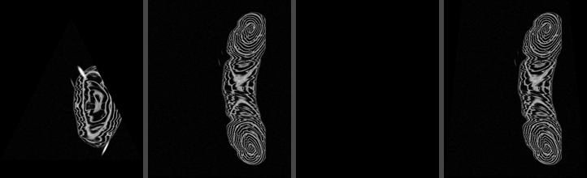
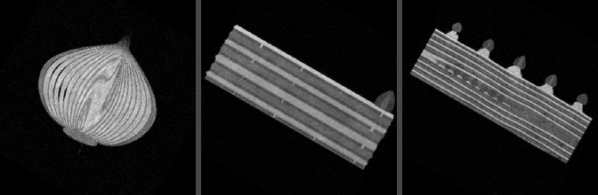
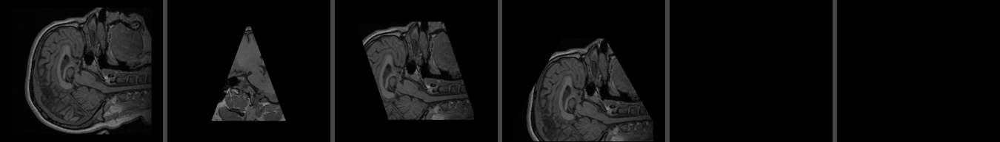
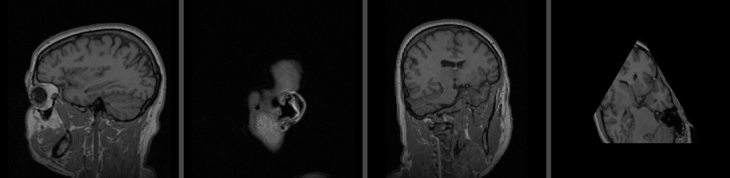
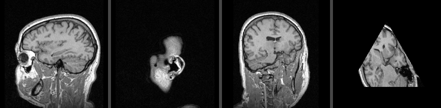

# Experiment and Results

## 1. Goal

1. Check that the program gives correct images on real data, for every voxel type.
2. Check the edge cases of the [test strategy](TESTING.md) on a real volume.
3. Measure the speed against the requirement: at least 100 FPS on a 500³ volume (NFR-1).
4. Compare the two intensity mappings (FR-20): minimum/maximum and percentiles.

## 2. Setup

- **Data:** the data set of [DATASET.md](DATASET.md): `MRHead_1.nrrd` and the class volumes,
  with their CSV files, the lecturer's example and our `demo/edge_cases.csv`.
- **Machine:** a cloud machine with 2 cores of an Intel Xeon at 2.1 GHz. This is a slow machine;
  on a modern laptop the numbers should be higher.
- **Software:** Python 3.13, NumPy 2.5, pynrrd 1.1, imageio-ffmpeg 0.6.
- **Commands:** `python Ex0.py <volume> <planes> <video>` for every pair, and
  `python tools/benchmark.py <volume>:<planes> ...` for repeated speed measurements.

## 3. Correctness

### 3.1 The lecturer's example on a 500³ volume

`python Ex0.py data/croissant.nrrd demo/class/lecturer_example.csv demo/results/lecturer_example.mp4`

Frames 1, 2 and 4 show the croissant through a triangle and two rectangles. Frame 3 is black,
with the warning `line 4: triangle is not isosceles: |ab|=497.3932, |ac|=476.8648`: the third
plane of the example is not isosceles, so it is rejected, as decided in the SRS (FR-9, FR-11).
The trapezoids confirm the point order `a1, b, a2, c` (FR-6).

### 3.2 MRI of the head

`head.csv` (280 planes) gives the expected anatomy: sagittal and coronal slices, and oblique
triangles through the head. The images are in voxel-index orientation (FR-7), so the head may
appear rotated or mirrored compared to the 3D Slicer views, which use the patient orientation.

### 3.3 Every voxel type

`onion` (uint8), `biscuit_cake` (uint16), `swiss_roll` (uint32), `MRHead_1` (signed int16) and
`croissant` (uint8, 500³) all give correct images. Frame 61 of the three 256 × 256 × 130 volumes:

### 3.4 Edge cases

`python Ex0.py data/MRHead_1.nrrd demo/edge_cases.csv demo/results/edge_cases.mp4`

The result matched every expectation written in the file:

- 18 frames, all of the same size (FR-19, FR-21).
- Frames 1 – 4: a slice, an oblique triangle, a **slanted parallelogram drawn slanted** (FR-18)
  and a triangle **partly outside the volume, black where it leaves** (FR-13).
- Frame 5: a valid plane completely outside the volume: black, **no warning**.
- Frames 6 – 16: invalid planes: black, and one warning lists all 11 with their line numbers
  (FR-9 – FR-11). The run continued: frames 17 and 18 are drawn.
- With `--strict`: all 11 errors were listed, no video was written, exit code 1 (FR-12).

### 3.5 Automated tests

All 113 tests pass (`pytest`). Among them: the fast projector gives **identical** images to the
loop-based reference on 240 random planes over all six voxel types (NFR-2).

## 4. Speed

### 4.1 The demo program

Reported by `Ex0.py`. *Projection FPS* counts projecting and placing each frame; *end-to-end FPS*
also counts writing the video; *load* is reading the volume and mapping it to 8 bit (FR-23).

| Volume | Planes | Frames | Frame size | Load (s) | Projection FPS | End-to-end FPS |
|---|---|---|---|---|---|---|
| croissant (500³, uint8) | croissant.csv | 100 | 502 × 502 | 1.51 | **146** | **116** |
| MRHead_1 (int16) | head.csv | 280 | 256 × 256 | 0.19 | 654 | 365 |
| onion (uint8) | onion.csv | 120 | 256 × 256 | 0.16 | 728 | 266 |
| biscuit_cake (uint16) | biscuit_cake.csv | 120 | 256 × 256 | 0.18 | 757 | 314 |
| swiss_roll (uint32) | swiss_roll.csv | 120 | 256 × 256 | 0.30 | 792 | 305 |

### 4.2 Projection only (benchmark)

`tools/benchmark.py` projects every plane three times without writing a video, and reports the
median. On this 2-core machine, the video encoder runs at the same time as the projection in
`Ex0.py` and takes one core, which is why the projection alone is faster here.

| Volume | Planes | Mean image (pixels) | Projection FPS | Loop reference (s per frame) |
|---|---|---|---|---|
| croissant (500³) | croissant.csv | 251,001 | 206 | 0.66 |
| MRHead_1 | head.csv | 57,543 | 1091 | 0.52 |
| onion | onion.csv | 65,536 | 1126 | 0.37 |
| biscuit_cake | biscuit_cake.csv | 65,536 | 1290 | 0.29 |
| swiss_roll | swiss_roll.csv | 65,536 | 1089 | 0.34 |

| Random 500³ uint8 volume | Image | Projection FPS |
|---|---|---|
| Slice | 500 × 500 | 195 |
| Diagonal triangle | 706 × 500 | 177 |
| Triangle around a full slice | 1000 × 1000 | 70 |

### 4.3 Findings

- **The requirement is met.** On the 500³ volume the projection runs at 146 – 206 FPS and the
  whole program, including the video, at 116 FPS, above the target of 100 and far above the
  minimum of 30, even on a slow 2-core machine.
- **No loops: about 140 – 570 times faster.** The loop-based reference needs 0.3 – 0.7 s per
  frame (about 2 FPS); the fast projector gives the same images.
- **Speed depends on the image size, not on the volume.** The 256 × 256 × 130 volumes run at about
  1100 FPS for 65,536-pixel images; the 500³ volume runs at about 200 FPS for 251,001-pixel images.
  The cost is about 16 – 20 ns per pixel.
- **Very large planes are slower.** A 1000 × 1000 image runs at 70 FPS on this machine. Such a
  plane is mostly outside the volume or margin; the maximum frame size (FR-19a) keeps it bounded.
- **Two optimizations mattered most:** the zero border around the volume (no per-pixel bounds
  test), and mapping the volume to 8 bit once at load time (FR-20), so the projector reads one
  byte per pixel. Working in place with 32-bit offsets added about 60%.

## 5. Intensity mapping

The same frames of `head.csv` with the default mapping (minimum/maximum of the volume, top) and
with `--percentiles 1 99` (bottom):

The MRI values are 0 – 279, but 99% of the voxels are below 134: a few very bright voxels set
the maximum, so with minimum/maximum most tissue is dark gray. With percentiles the brightest 1%
is clipped to white, and the frames are about twice as bright (mean gray of frame 41: 37 → 77)
with clearer tissue contrast. Both mappings use one range for the whole volume, so a value has
the same gray in every frame.

**Conclusion:** minimum/maximum stays the default, since it never hides a value, and
`--percentiles 1 99` is recommended for MRI scans.

## 6. Result videos

In `demo/results/`:

| File | Content |
|---|---|
| `lecturer_example.mp4` | The lecturer's example on `croissant.nrrd` |
| `edge_cases.mp4` | Our edge cases on `MRHead_1.nrrd` |
| `head_percentiles.mp4` | `head.csv` on `MRHead_1.nrrd`, with `--percentiles 1 99` |
| `croissant.mp4` | `croissant.csv` on `croissant.nrrd` (500³) |

## 7. Limitations

- Points are voxel indices (FR-7): for volumes with non-cubic voxels (`MRHead_1`: 1 × 1 × 1.3 mm)
  the images are slightly stretched, and the orientation is the index orientation.
- Nearest-voxel sampling (FR-17) gives slightly jagged edges on oblique planes.
- The speeds above are from one slow cloud machine; they should be measured again on the
  machine used for the demo.
